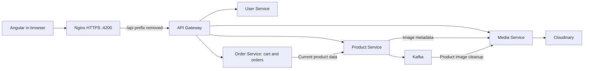
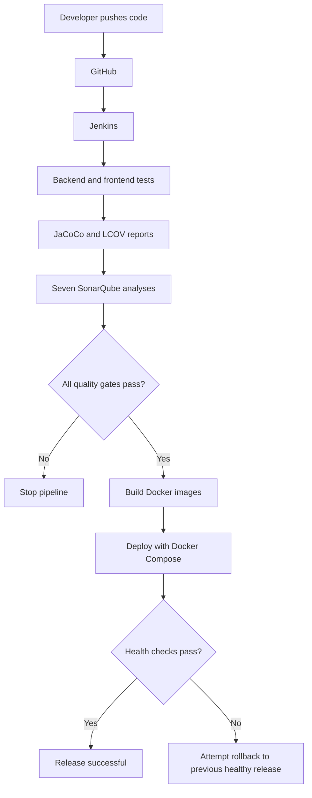

# Buy02 — E-Commerce Marketplace with CI/CD

Buy02 extends the Buy01 marketplace with **shopping carts**, **Pay on Delivery checkout**, **order management**, **product search/filtering**, and **customer/seller profile analytics**. It uses **Spring Boot microservices** and **Angular**, with **Jenkins + SonarQube** for automated testing, code analysis, and Docker deployment.

The target experience is browsing → cart → checkout → order tracking, with purchasing and sales dashboards. Some required Buy02 features are still pending; the table below describes the current source code, not a verified deployed release.

## Buy02 scope and implementation status

| Feature | Current implementation | Remaining work |
| --- | --- | --- |
| Accounts and profiles | Registration, login, JWT authentication, profile viewing/editing | Verify dashboards against deployed order data |
| Product discovery | Keywords, category, price and stock filters, sorting, pagination; Angular catalog and MongoDB indexes | Verify behavior and query performance with representative data |
| Cart | Persistent client cart, add/update/remove/clear, availability checks and totals | Verify full integration and critical end-to-end scenarios |
| Pay on Delivery | Address → review → confirmation; review tokens, idempotency keys and checkout recovery | Verify retry and failure handling in deployment |
| Orders | Customer/seller pages, paginated search, details/timeline, cancellation, reorder-to-cart and status updates; category snapshots and stock reservation | Removal/archive behavior and further failure-recovery validation |
| Customer analytics | Delivered-order spending, order count, units, top products/categories and monthly charts in the profile | Verify live integration and team acceptance of financial rules |
| Seller analytics | Delivered-order revenue, units sold, best sellers, categories and monthly sales/order trends in profile and seller dashboard | Verify live integration and team acceptance of financial rules |
| Testing and delivery | Backend/Angular tests, Jenkins pipeline, SonarQube and GitHub quality workflow | Verify the new browser job on CI and the staging deployment |

Wishlist and additional payment methods are optional bonuses. Analytics use real order snapshots and authenticated identity. This implementation counts only `DELIVERED` orders for all figures, excluding cancelled and undelivered orders; this treats Pay on Delivery amounts as realized spending/revenue. The team should confirm this policy before merging. Category snapshots are stored on new orders; missing or blank historical categories count as `uncategorized`.

## Team responsibilities

| Developer | Primary ownership |
| --- | --- |
| Anass | Cart backend, Angular cart, Pay on Delivery checkout and checkout-to-order integration |
| Abdelillah | Orders Microservice, shared order contract, lifecycle rules, customer/seller order screens |
| Ayoub | Product search/filtering, customer and seller analytics APIs, profile dashboards and charts |

All three developers contribute tests, security checks, API documentation, integration testing, feature-branch PRs, reviews, and fixes from SonarQube. Agree on shared contracts before changing checkout/order integration or analytics inputs.

Infrastructure identifiers inherited from Buy01 (such as `buy01-env`, container names, SonarQube keys and Java packages) remain in use. Use the exact names documented below; changing the project title does not rename these resources.

## At a glance

| Layer | Technology | Responsibility |
| --- | --- | --- |
| Frontend | Angular | Marketplace UI for clients and sellers |
| Backend | Spring Boot | User, Product, Media, Order (including cart), Gateway, and Discovery services |
| Data | MongoDB | Application data |
| Events | Apache Kafka | Asynchronous service events |
| Media | Cloudinary | Uploaded product images |
| CI/CD | Jenkins | Tests, packaging, scanning, building, deployment |
| Code quality | SonarQube | Static analysis and quality gates |
| Coverage | JaCoCo, LCOV | Java and frontend test coverage |
| Infrastructure | Docker Compose + Docker-in-Docker | Isolated services and application deployment |

## Application architecture



Eureka provides service discovery. Each business service has its own MongoDB database. The gateway validates JWTs, removes incoming identity headers, and forwards authenticated user/role headers. Services enforce role and ownership rules using that context, so internal service reachability is part of the security boundary.

The browser uses same-origin `/api/...` URLs through Nginx. API paths in this README refer to **https://localhost:4200/api**, not direct access to each service.

## CI/CD workflow



The application runs inside the `jenkins-docker` Docker daemon. The host's normal `docker ps` shows infrastructure containers; use `docker exec jenkins-docker docker ps` to inspect deployed application containers.

## Requirements

- Linux, Git, OpenSSL, Docker Engine, and Docker Compose v2
- Permission to run Docker commands
- A GitHub account/token with read access to the repository
- Cloudinary credentials if you want to test image uploads
- Sufficient free memory and disk for Jenkins, SonarQube, and builds (approximately 8 GB available RAM is a useful starting point)

SonarQube's Elasticsearch needs a suitable host setting:

```bash
sysctl vm.max_map_count
```

If it is below `524288`, ask your system administrator to configure it. This is a **host** setting, not a Docker cache problem.

## Run this checkout locally without Jenkins

Use this path to test a feature branch with the host Docker daemon. It uses separate `buy02-local-*` containers, networks and database volumes; Jenkins deployment remains a separate workflow.

Requirements: Docker Engine with Compose v2, Java 21, Node.js/npm and OpenSSL. Ports 4200, 8444, 9092 and the database ports in `docker-compose.yml` must be available. Stop the failing `jenkins-docker` container first if it occupies port 4200; other containers using those ports must also be stopped or reconfigured.

From the repository root:

```bash
bash scripts/run-local.sh
```

The script builds backend JARs and Angular, generates private development credentials and self-signed certificates under ignored `.local/`, builds Docker images, and waits for the stack to become healthy. Open **https://localhost:4200** and accept the local certificate warning. Register a CLIENT or SELLER; this stack starts with empty databases.

Set real `CLOUDINARY_CLOUD_NAME`, `CLOUDINARY_API_KEY` and `CLOUDINARY_API_SECRET` in `.local/app.env`, then rerun the script to enable image uploads. Without these values, accounts, catalog reads and empty analytics can be tested, but product image uploads will fail. Do not replace database passwords after the local volumes have been initialized.

If the JARs and Angular build already match the current code, skip rebuilding those artifacts:

```bash
bash scripts/run-local.sh --skip-build
```

Inspect or stop this local stack:

```bash
docker compose --env-file .local/app.env -p buy02-local -f docker-compose.yml -f compose.local.yml ps
docker compose --env-file .local/app.env -p buy02-local -f docker-compose.yml -f compose.local.yml logs --tail=100
docker compose --env-file .local/app.env -p buy02-local -f docker-compose.yml -f compose.local.yml stop
```

Keep `.local/` private and preserve it between restarts. The instructions below describe the full Jenkins/SonarQube installation instead.

## Quick start — Jenkins fresh installation

> Commands below are for **Bash on Linux**, from the repository root. This is a fresh-install guide: do not overwrite existing secrets or delete volumes when updating an existing installation.

### 1. Clone and prepare configuration

```bash
git clone https://github.com/AyyoubMh48/buy-02.git
cd buy-02

umask 077
mkdir -p jenkins-lab/jenkins-secrets
chmod 700 jenkins-lab/jenkins-secrets
cp jenkins-lab/.env.example jenkins-lab/.env
cp .env.example jenkins-lab/jenkins-secrets/buy01-env
```

Edit these two files **before starting the application**:

| File | What to configure |
| --- | --- |
| `jenkins-lab/.env` | `SONAR_DB_PASSWORD` for SonarQube PostgreSQL |
| `jenkins-lab/jenkins-secrets/buy01-env` | `JWT_SECRET`, JWT expiration, MongoDB credentials, Cloudinary credentials, gateway keystore password |

Generate a JWT secret with `openssl rand -hex 32`. Keep all local secrets out of Git. The `buy01-env` file must contain valid shell `KEY=value` lines; quote values containing shell-special characters.

Create the Jenkins admin password and GitHub checkout credentials using hidden prompts:

```bash
read -rsp 'Jenkins admin password: ' value; echo
printf '%s\n' "$value" > jenkins-lab/jenkins-secrets/jenkins-admin-password
unset value

read -rp 'GitHub username: ' value
printf '%s\n' "$value" > jenkins-lab/jenkins-secrets/github-username
unset value

read -rsp 'GitHub read-access token: ' value; echo
printf '%s\n' "$value" > jenkins-lab/jenkins-secrets/github-pat
unset value
```

If you already cloned the repository, start with `umask 077` from your checkout instead of cloning again.

The Jenkins job checks out `main` from the repository configured in `jenkins-lab/jcasc/jenkins.yaml`. Set that URL to the repository you intend to deploy (for this checkout, `https://github.com/AyyoubMh48/buy-02.git`), and ensure the GitHub token can read it. Push changes before running the job: local, uncommitted edits are not included. Testing a feature branch requires configuring the job to check out that branch; the default job builds `main`.

### 2. Generate local HTTPS certificates

```bash
openssl req -x509 -newkey rsa:2048 -sha256 -nodes -days 365 \
  -keyout jenkins-lab/jenkins-secrets/gateway-keystore.key \
  -out jenkins-lab/jenkins-secrets/gateway-keystore.crt \
  -subj '/CN=localhost' \
  -addext 'subjectAltName=DNS:localhost,DNS:gateway,IP:127.0.0.1'

openssl pkcs12 -export -name gateway \
  -inkey jenkins-lab/jenkins-secrets/gateway-keystore.key \
  -in jenkins-lab/jenkins-secrets/gateway-keystore.crt \
  -out jenkins-lab/jenkins-secrets/gateway-keystore.p12

chmod 600 jenkins-lab/.env jenkins-lab/jenkins-secrets/*
```

Use **the same export password** you configured as `SERVER_SSL_KEY_STORE_PASSWORD` in `buy01-env`. These are self-signed **development** certificates, not public-production certificates.

### 3. Start SonarQube and PostgreSQL

```bash
docker compose -f jenkins-lab/compose.yml config --quiet
docker compose -f jenkins-lab/compose.yml up -d --wait --wait-timeout 900 sonar-db sonarqube
```

Open **http://localhost:9000**. On a new instance, log in with `admin` / `admin`, change the default password, and go to **My Account → Security**. Generate an administrator **User Token** (not a Project Analysis Token).

Save it without printing it:

```bash
read -rsp 'SonarQube administrator User Token: ' sonar_admin_token; echo
printf '%s\n' "$sonar_admin_token" > jenkins-lab/jenkins-secrets/sonar-bootstrap-token
unset sonar_admin_token
chmod 600 jenkins-lab/jenkins-secrets/sonar-bootstrap-token
```

### 4. Provision SonarQube projects and tokens

```bash
docker compose -f jenkins-lab/compose.yml --profile bootstrap run --rm sonar-init
```

Successful output should end with `Provisioning complete; recreate Jenkins to load secret files`.

The bootstrap prepares **seven SonarQube projects**, their analysis tokens, and the internal Jenkins quality-gate webhook:

| Component | SonarQube project key | Jenkins credential ID |
| --- | --- | --- |
| Product Service | `buy01-product-service` | `sonar-product-token` |
| User Service | `buy01-user-service` | `sonar-user-token` |
| Media Service | `buy01-media-service` | `sonar-media-token` |
| Order Service (Cart & Checkout) | `buy01-order-service` | `sonar-order-token` |
| API Gateway | `buy01-gateway` | `sonar-gateway-token` |
| Eureka Discovery | `buy01-discovery` | `sonar-discovery-token` |
| Angular frontend | `buy01-frontend` | `sonar-frontend-token` |

**Why this step comes first:** Jenkins loads local analysis-token files when its startup configuration runs. SonarQube projects do not need to exist for Jenkins to define a server installation, but valid projects and tokens are required for successful scans.

### 5. Start Jenkins

```bash
docker compose -f jenkins-lab/compose.yml up -d --build --wait --wait-timeout 900 docker jenkins
docker compose -f jenkins-lab/compose.yml ps
```

Open **http://localhost:8085**, sign in as `admin` using the password from step 1, and verify:

- **Manage Jenkins → System → SonarQube installations** shows `SonarQube` at `http://sonarqube:9000`.
- **Manage Jenkins → Credentials** contains the seven SonarQube credential IDs.
- The `first-pipeline` job exists.

**Important JCasC check:** Having SonarQube settings inside `/casc/jenkins.yaml` does **not** prove Jenkins applied them. In **Manage Jenkins → Configuration as Code**, check the **last applied configuration path** and verify that the server installation is actually visible. If Jenkins applies `/tmp/jenkins-base.yaml` without the Sonar section, investigate the startup/JCasC generation path instead of manually adding the server or clearing Docker volumes.

### 6. Run the pipeline

In Jenkins, open **`first-pipeline` → Build Now → Console Output**.

The expected sequence is:

1. Checkout from GitHub.
2. Run backend tests, package JARs, and generate JaCoCo coverage.
3. Run Angular tests, generate LCOV coverage, and build the frontend.
4. Analyze all seven projects in SonarQube and wait for their quality gates.
5. Only if all gates pass, build Docker images tagged with the Jenkins build number.
6. Deploy the application, check health, and attempt rollback when an eligible previous release exists and deployment health fails.

A green Jenkins result is meaningful only if the deployment and health-check stages ran as expected. **This setup builds images locally inside Docker-in-Docker; it does not push images to Docker Hub.**

### 7. Open and test the marketplace

| Service | URL |
| --- | --- |
| Marketplace | **https://localhost:4200** |
| Jenkins | http://localhost:8085 |
| SonarQube | http://localhost:9000 |

The browser may warn about the self-signed development certificate.

Test the implemented flow:

1. Register as a **SELLER** and create several products with images, different categories, prices and stock quantities. Cloudinary credentials are required for uploads.
2. Browse `/products` as a visitor or **CLIENT**. Test keyword/category/price/stock filters, sorting, pagination, and empty results.
3. As a **CLIENT**, add products to `/cart`, change quantities, remove items and check totals.
4. Open `/checkout`, enter the delivery address, review the order and confirm **Pay on Delivery**. Check the success response and that the cart clears after confirmation.
5. Open **My orders** as a client, or **Orders** as a seller. Check details, search, status/date filters, pagination, cancellation and order-again actions.
6. As a seller, advance an eligible order through `CONFIRMED`, `SHIPPED`, and `DELIVERED`. Visit `/seller/dashboard` or `/profile` to see sales analytics. As the client, visit `/profile` to see purchasing analytics.
7. Apply dates containing the order placement date. Check the totals, top products/categories, and monthly chart. Orders still pending, confirmed, shipped or cancelled must not contribute. For mixed-seller orders, verify each seller sees only their own line amounts.

These steps are the manual smoke test. The automated browser suite below covers search, checkout, delivery and analytics; health checks alone do not establish that purchases work.

Quick checks:

```bash
curl -kfsS -o /dev/null https://localhost:4200/index.html
curl -kfsS https://localhost:4200/actuator/health
docker exec jenkins-docker docker ps
```

The health response should include `"status":"UP"` when the gateway is healthy.

## Repository guide

| Path | Purpose |
| --- | --- |
| `Jenkinsfile` | CI/CD pipeline definition |
| `jenkins-lab/compose.yml` | Jenkins, Docker-in-Docker, SonarQube, PostgreSQL |
| `jenkins-lab/jcasc/jenkins.yaml` | Jenkins Configuration as Code source |
| `jenkins-lab/docker-entrypoint.sh` | Loads local secrets and prepares Jenkins configuration |
| `jenkins-lab/sonar-init/bootstrap.py` | Provisions SonarQube projects, tokens, and webhook |
| `jenkins-lab/jenkins-secrets/` | Local credentials and certificates — **never commit** |
| `product-service/`, `user-service/`, `media-service/` | Business microservices |
| `order-service/` | Cart, checkout, order persistence, search and lifecycle APIs |
| `gateway/`, `discovery/` | API routing and service discovery |
| `frontend/` | Angular marketplace |
| `.github/workflows/quality.yml`, `.ci/` | GitHub quality workflow, provisioning tests and review/protection documentation |

## Everyday commands

Start existing infrastructure:

```bash
docker compose -f jenkins-lab/compose.yml up -d --build
```

This starts the CI infrastructure using existing configuration. If the application has not been deployed, run `first-pipeline` in Jenkins afterwards. Redeploy code changes through the pipeline. The root `docker-compose.yml` expects prebuilt images tagged with `APP_IMAGE_TAG` and Jenkins-managed certificate paths; it is not a standalone build-and-run shortcut.

Check status and logs:

```bash
docker compose -f jenkins-lab/compose.yml ps
docker compose -f jenkins-lab/compose.yml logs --tail=100 jenkins sonarqube
docker exec jenkins-docker docker ps
```

After changing local secret files, recreate Jenkins so its entrypoint can reload them:

```bash
docker compose -f jenkins-lab/compose.yml up -d --force-recreate jenkins
```

Stop without deleting data:

```bash
docker compose -f jenkins-lab/compose.yml stop
```

**Avoid `down -v` for routine troubleshooting:** it removes persistent data such as Jenkins and SonarQube state.

## Troubleshooting

| Symptom | First thing to check |
| --- | --- |
| SonarQube Elasticsearch fails to start | Host `vm.max_map_count`, memory, and SonarQube logs |
| `Number of installations ... 0` | Jenkins **System → SonarQube installations** and actual JCasC source applied |
| `Not authorized to analyze` / HTTP 401 | Correct project key, matching analysis token, permissions |
| Quality Gate times out | SonarQube webhook delivery to `http://jenkins:8080/sonarqube-webhook/` |
| Coverage report missing | `target/site/jacoco/jacoco.xml` or `frontend/coverage/frontend/lcov.info` |
| Docker image/container not visible on host | Inspect nested daemon with `docker exec jenkins-docker docker ps` |
| MongoDB/PostgreSQL login fails after password change | Existing database volumes retain initialized credentials |
| Angular loads but `/api` calls fail during `npm start` | The Angular development server has no API proxy configured; use the deployed HTTPS application for full-stack testing |
| Latest edits do not appear after a pipeline run | Jenkins checks out its configured remote branch, not your local working directory |

For a full failure, inspect the **first real error** in Jenkins Console Output, not just the final `Finished: FAILURE` line. Never paste tokens or secret-file contents into issue reports.

## Important limitations

- Product persistence and Kafka publication are separate operations; failures can leave product and media state inconsistent.
- Stock reservation and order persistence span services. Compensation failures require reconciliation; consult the Order Service documentation.
- Order removal/archive is not implemented. The status applies to the whole order, including mixed-seller orders.
- Analytics support at most 366 days per request and count delivered orders by placement date, not delivery date. Revenue is inferred from delivery status; there is no payment collection ledger.
- The GitHub webhook needs an externally reachable Jenkins URL; `localhost:8085` is not reachable by GitHub.
- SonarQube Community Build does not provide native PR/branch analysis. The [GitHub quality workflow](.ci/README.md) performs isolated whole-code scans on every branch and PR without overwriting the main dashboard.
- Bootstrap assigns the Buy01 Quality Gate: at least 80% overall/new-code coverage, zero overall bugs/vulnerabilities and zero new issues, at most 3% new duplication, and all new security hotspots reviewed. Frontend coverage additionally enforces 80% in four metrics.
- The included self-signed certificates and Docker-in-Docker setup are intended for local development/lab use.
- Rollback is conditional on a previous healthy release and is not a substitute for database migration planning.

## Quality checks and reviews

See [.ci/README.md](.ci/README.md) for automatic scans, retained reports, required reviews, and the prepared GitHub branch-protection rule. Protected branches still require a qualifying GitHub plan for this private repository.

## Running checks locally

Use a JDK compatible with the build (CI uses Java 21), Node.js (CI uses `24.20.0`) and npm. Maven wrappers are included. These commands run checks; they do not start the full application.

Backend tests, packages and JaCoCo reports, from the repository root:

```bash
for service in product-service user-service media-service order-service gateway discovery; do
  (cd "$service" && bash ./mvnw -B clean verify) || break
done
```

Frontend tests and production build:

```bash
cd frontend
npm ci
CI=true npm run test:coverage
npm run build
```

Individual tests may need environment variables or infrastructure; inspect the first failure and the relevant service configuration. Jenkins supplies the configured application credentials during its build.

`npm start` starts Angular alone at `http://localhost:4200`; there is currently no development API proxy. It also conflicts with the deployed frontend's host port. For full-stack manual testing, use the Docker/Jenkins deployment at **https://localhost:4200**. Real-browser end-to-end tests are available through `npm run test:e2e`, as described below.

## Browser end-to-end tests

Start the local application from this checkout with `bash scripts/run-local.sh`, then:

```bash
cd frontend
npm run test:e2e
```

The suite uses the existing Puppeteer dependency and Node's test runner. It selects `PUPPETEER_EXECUTABLE_PATH` when set, then `/usr/bin/google-chrome` if installed, otherwise Puppeteer's installed browser. If needed, install Chrome with `npx puppeteer browsers install chrome`. Environments where Chrome's sandbox cannot run can explicitly use `E2E_NO_SANDBOX=1 npm run test:e2e`; CI sets this for its disposable runner.

Tests run against **https://localhost:4200**, require the `buy02-local-*` containers, and refuse fixture writes to a different Compose project. They register fresh browser accounts, insert uniquely named product fixtures into the local Product MongoDB, and remove their exact account/product/order/cart/receipt records afterwards. Production data and Cloudinary are not used. Product fixtures bypass image upload; Cloudinary upload behavior is covered separately by storage-error tests and manual integration testing.

Five scenarios cover real browser requests through Angular → Nginx → Gateway → services → MongoDB:

- Keyword/category/price/stock filters, sorting, pagination reset, invalid ranges and empty results.
- Mixed-seller cart, quantity edits, Pay on Delivery checkout and cart clearing; pending orders contribute zero analytics.
- Seller confirmation/shipping/delivery, customer totals, seller-only line totals, and ownership/role restrictions.
- Customer cancellation of a second order without changing delivered analytics.
- Inclusive placement-day filters, excluded dates, invalid date ranges and dashboard use at mobile width.

Tests run serially because later steps use the order created by checkout. Failures save screenshots under ignored `frontend/e2e/artifacts/`; CI retains these with its quality artifacts. GitHub Actions installs Puppeteer's matching Chrome build, starts a fresh local stack, runs the browser suite, and stops it before starting SonarQube to keep memory usage bounded. The app remains running after a local test run.

Cloudinary storage failures now return HTTP 502 with a controlled message instead of exposing provider errors as unhandled 500 responses. Angular displays that message through its existing upload error handling.

## Cart and checkout API

All endpoints below require an authenticated **CLIENT**. Cart identity comes from the authenticated user, not a user ID supplied by the caller.

| Method | Public path | Purpose |
| --- | --- | --- |
| `GET` | `/api/cart` | Read cart with current product information and totals |
| `POST` | `/api/cart/items` | Add `{ "productId": "...", "quantity": 1 }` |
| `PUT` | `/api/cart/items/{productId}` | Set quantity with `{ "quantity": 2 }` |
| `DELETE` | `/api/cart/items/{productId}` | Remove an item |
| `DELETE` | `/api/cart` | Clear cart |
| `POST` | `/api/cart/review` | Validate availability and obtain a review token |
| `POST` | `/api/cart/checkout` | Submit delivery address and review token using an `Idempotency-Key` header |

The cart supports up to 50 distinct products and quantities from 1 to 100 per product, subject to stock checks. Checkout uses cash on delivery. On uncertain failures, retry the same request with the same key; pending checkout data is persisted for recovery.

Mutating gateway requests also require CSRF protection: obtain the token from `GET /api/csrf`, retain its cookie, and send the token in `X-XSRF-TOKEN`. The Angular interceptor handles this automatically. Protected requests use `Authorization: Bearer <token>`.

## Orders API

| Method | Public path | Purpose |
| --- | --- | --- |
| `POST` | `/api/orders` | Create a client order; requires `Idempotency-Key` |
| `GET` | `/api/orders/my` | List the authenticated customer's orders |
| `GET` | `/api/orders/seller` | List orders containing the authenticated seller's products |
| `GET` | `/api/orders/{id}` | Read an owned customer order or seller-related order |
| `PATCH` | `/api/orders/{id}/cancel` | Customer cancellation when the current state permits it |
| `POST` | `/api/orders/{id}/reorder` | Return prior order items for a repeat purchase |
| `PATCH` | `/api/orders/{id}/status` | Related seller updates status with optional note |

List filters: `status`, ISO dates `from`/`to` (inclusive), and `q` (order ID or product-name text). Lists also accept `page` and `size` and return paginated responses. Responses contain product/price/category snapshots, totals and status history. Seller responses restrict items and totals to the seller's products.

Allowed transitions: `PENDING → CONFIRMED → SHIPPED → DELIVERED`, with cancellation allowed from `PENDING` or `CONFIRMED`. `DELIVERED` and `CANCELLED` are terminal states. Status is currently stored for the whole order, including orders with multiple sellers.

The Buy02 subject calls for consistent errors shaped as `{ code, message, details }`. Existing services use different error schemas; alignment remains required. Analytics endpoints are documented below.

## Product categories

Product create/update requests accept an optional `category` string of at most 80 characters. Categories are trimmed and stored in lowercase (for example, `" Furniture "` becomes `"furniture"`). New products without a category, and existing uncategorized products in API responses, use `"uncategorized"`. An update that omits `category` preserves the existing value. Existing MongoDB documents do not require a migration for this change.

Sellers can edit the category in the product form. Category filtering is supported by the product search endpoint below.

## Product search API

`GET /api/products/search` is a public, read-only endpoint. The existing product list and product-by-ID endpoints retain their response formats for cart/order compatibility.

Example:

```http
GET /api/products/search?q=phone&category=electronics&minPrice=500&maxPrice=3000&inStock=true&sort=price-asc&page=0&size=12
```

| Parameter | Behavior |
| --- | --- |
| `q` | Optional keywords in name/description, up to 200 characters. MongoDB text search matches words, not arbitrary substrings. The text index uses language `none` (no stemming or stop-word removal). Multiple terms use MongoDB text-search semantics, including OR by default. |
| `category` | Optional exact category, trimmed and lowercased. `uncategorized` includes legacy missing/blank values. |
| `minPrice`, `maxPrice` | Optional inclusive bounds, nonnegative with up to 12 integer digits and 2 decimal places. Minimum must not exceed maximum. |
| `inStock` | `true` limits results to positive stock; omitted/`false` includes all stock levels. |
| `sort` | `newest` (default), `featured` (alias for newest), `price-asc`, `price-desc`, or `name-asc`. All include an ID tie-breaker. Name sorting uses MongoDB's default binary ordering. |
| `page`, `size` | Zero-based page (0–10000, default 0), page size (1–100, default 12). |

The response contains `content` (product responses), `totalElements`, `totalPages`, `page`, and `size`. Counts apply to all matches before pagination. No matches produce an empty list and zero total pages; a page beyond the last page is empty and retains the matching totals. Invalid filters return HTTP 400 using the existing validation error response.

Spring Data creates the combined name/description text index and category/price, price, and creation-date indexes on startup when `spring.data.mongodb.auto-index-creation=true` (already configured). MongoDB must be available and its application user must have permission to create indexes. These indexes support the basic search paths; query plans for combined filters/sorts should be checked against representative data. The Angular catalog uses this endpoint for search, category/price/stock filters, sorting, and pagination (12, 24, or 48 items per page). Filter changes reset the page and wait 300 ms before searching; newer changes cancel pending or in-flight requests. Invalid price ranges are shown inline and do not send requests. The existing quick view and add-to-cart actions remain available.

## Orders

The Order Service handles the cart, Pay on Delivery checkout and orders; the Angular app has customer and seller order pages.

| Area | Summary |
| --- | --- |
| Customer | cart, checkout, order history with search, status and date filters, order details with a status timeline, cancel (pending or confirmed orders), order again |
| Seller | orders containing their products (only their own lines and totals), status updates with an optional note |
| Statuses | `PENDING` → `CONFIRMED` → `SHIPPED` → `DELIVERED`, or `CANCELLED` before shipping; invalid changes return 409 |
| Safety | product and price snapshots, exact decimal amounts, one order per `Idempotency-Key`, stock reserved in Product Service before saving, optimistic locking against concurrent updates |
| API | `/api/orders/**` and `/api/cart/**` through the gateway |

Details:

- [order-service/README.md](order-service/README.md): architecture, security, concepts, data model, API, flows, configuration, tests, limitations, and the analytics contract.
- [frontend/src/app/features/orders/README.md](frontend/src/app/features/orders/README.md): the order pages, their code and tests.

Improvements from SonarQube during this work:

| Rule | Finding | Fix |
| --- | --- | --- |
| `java:S5778` | `assertThatThrownBy` lambdas built their arguments inside the lambda, so a test could pass for the wrong exception | arguments are built before the assertion |
| `Web:S6819` | the cancel confirmation used `role="group"` | replaced by a native `<fieldset>` with a `<legend>` |

## Profile analytics

Customer purchasing analytics appear at `/profile`. Seller sales analytics appear at both `/profile` and `/seller/dashboard`. Both show summary cards, top-five products/categories and monthly charts with readable table values. Date filters, loading/error/retry states and empty results are supported.

| Method | Public path | Access |
| --- | --- | --- |
| `GET` | `/api/orders/analytics/me?from=2026-01-01&to=2026-12-31` | Authenticated CLIENT, own orders |
| `GET` | `/api/orders/analytics/seller?from=2026-01-01&to=2026-12-31` | Authenticated SELLER, own items only |

Both endpoints return `from`, `to`, `countedStatus`, `totalAmount`, `orderCount`, `totalUnits`, `products`, `categories`, and `months`. `totalAmount` means customer spending or seller revenue depending on the endpoint. No caller-supplied user/seller ID is accepted as the analytics identity.

Dates are inclusive UTC order-placement dates. With no dates, the range starts on the first day of the month 11 months before today and ends today. Either bound may be omitted; an omitted `to` means today and an omitted `from` is derived from the effective end date. Ranges may include at most 366 days and must stay between years 1970 and 9998. Invalid dates/ranges return 400; absent authentication returns 401; wrong roles return 403.

Only delivered orders count. Products/categories are ranked by units, amount, then ID/category for deterministic ties; lists contain at most five entries. Product names and categories come from historical snapshots. Monthly totals include zero-filled months, count distinct orders rather than order lines, and use only the authenticated seller's lines for seller reports. Amounts are summed as MongoDB Decimal128/Java BigDecimal; the UI follows the existing order pages' USD display convention.

See [order-service/README.md](order-service/README.md#14-analytics-contract) for the full response contract and tests.

## Project status

The setup and pipeline above describe the **intended reproducible workflow**. Verify the live Jenkins build, quality-gate results, deployment, and application functionality before describing a release as successful.


