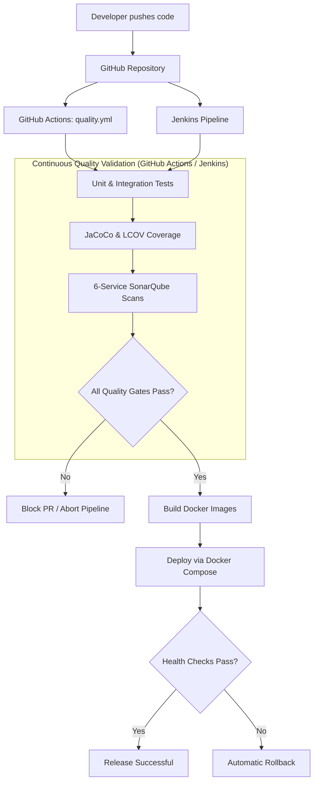

# SafeZone — Microservices Platform Code Quality & Security with SonarQube

[](https://github.com/anasbaip/safe-zone/actions/workflows/quality.yml)

A full-stack e-commerce microservices platform built with **Spring Boot** and **Angular**, integrated with **SonarQube**, **GitHub Actions**, and **Jenkins** to enforce automated static code analysis, quality gates, and secure CI/CD pipelines.

---

## Overview & Role Play

As a **DevOps and Quality Assurance Engineer**, the mission in **SafeZone** is to implement continuous code quality checks across all microservices, ensuring that vulnerabilities, code smells, and low-coverage code are detected early and prevented from reaching production.

### Core Objectives
* **Containerized SonarQube**: Deploy and manage SonarQube and PostgreSQL using Docker.
* **Multi-Service Analysis**: Independently analyze 6 distinct microservices with service-specific quality tokens and metrics.
* **Dual CI/CD Integration**:
  * **GitHub Actions**: Automated whole-code static analysis and quality gate enforcement on every push and pull request across all branches.
  * **Jenkins Pipeline**: Production-grade CI/CD pipeline gating Docker image builds and deployment on 100% passing quality gates.
* **Strict Quality Gates**: Enforce zero vulnerabilities, zero bugs, minimum 80% coverage, and reviewed security hotspots.
* **Continuous Monitoring**: Retain historical trends through persistent dashboards and automated nightly scheduled scans.
* **Branch Protection & Review**: Enforce a mandatory peer-review and CI quality gate check before merging pull requests.

---

## SafeZone Compliance Matrix

How the project fulfills every instruction and constraint of the SafeZone specification:

| # | Specification Requirement | Implementation in SafeZone | Location |
|---|---|---|---|
| **1** | **SonarQube Setup with Docker** | Persistent SonarQube + Postgres stack in `jenkins-lab/` and ephemeral isolated CI runner in `.ci/` | [jenkins-lab/compose.yml](jenkins-lab/compose.yml)<br>[.ci/compose.sonar.yml](.ci/compose.sonar.yml) |
| **2** | **Multi-Service Configuration** | 6 isolated projects configured with dedicated tokens, keys, and profiles: Gateway, Discovery, Product, User, Media, Frontend | [jenkins-lab/sonar-init/bootstrap.py](jenkins-lab/sonar-init/bootstrap.py)<br>[.ci/sonar_ci.py](.ci/sonar_ci.py) |
| **3** | **GitHub Integration** | Automated workflow triggers on all branch pushes and PRs; webhook support for Jenkins push triggers | [.github/workflows/quality.yml](.github/workflows/quality.yml)<br>[Jenkinsfile](Jenkinsfile#L7-L11) |
| **4** | **Automated Code Analysis & Quality Gates** | Pipelines immediately abort/fail builds if vulnerabilities, code smells, or coverage thresholds fail | [Jenkinsfile](Jenkinsfile#L210-L224)<br>[.ci/sonar_ci.py](.ci/sonar_ci.py) |
| **5** | **Continuous Monitoring** | Nightly automated scans (GitHub Actions at 02:17 UTC, Jenkins cron `H H(1-4) * * *`) + persistent web dashboard | [.github/workflows/quality.yml](.github/workflows/quality.yml#L6-L7)<br>[Jenkinsfile](Jenkinsfile#L10) |
| **6** | **Review & Approval Process** | Branch protection rules requiring approved reviews and passing quality gate status checks before merging | [.ci/main-protection.json](.ci/main-protection.json)<br>[.ci/README.md](.ci/README.md) |

---

## Architecture & Microservices

| Component | Technology | Responsibility | SonarQube Project Key |
|---|---|---|---|
| **API Gateway** | Spring Cloud Gateway (Java 21) | TLS termination, JWT validation, routing | `buy01-gateway` |
| **Discovery Service** | Netflix Eureka (Java 21) | Service registry and dynamic lookup | `buy01-discovery` |
| **Product Service** | Spring Boot, MongoDB (Java 21) | Product catalog and inventory | `buy01-product-service` |
| **User Service** | Spring Boot, MongoDB (Java 21) | User authentication and accounts | `buy01-user-service` |
| **Media Service** | Spring Boot, Cloudinary (Java 21) | Image upload and CDN processing | `buy01-media-service` |
| **Frontend** | Angular, Jasmine/Karma (Node 24) | Client & Seller marketplace web UI | `buy01-frontend` |
| **Message Broker** | Apache Kafka | Asynchronous inter-service events | — |
| **Quality & CI/CD** | SonarQube, GitHub Actions, Jenkins | Code quality gates, automated testing, deployment | — |

---

## CI/CD Pipeline Workflow



### Quality Gate Criteria ("Buy01 Quality Gate")
* **New Code Security Hotspots**: 100% reviewed.
* **New Code Duplication**: $\le 3\%$.
* **New Code Coverage**: $\ge 80\%$.
* **Overall Coverage**: $\ge 80\%$ on backend and all four frontend metrics (Statements, Branches, Functions, Lines).
* **Bugs & Vulnerabilities**: Exactly **0 allowed**; pipeline immediately terminates upon failure.

---

## Prerequisites & Requirements

- Linux OS with Git, OpenSSL, Docker Engine 24+, and Docker Compose v2.
- A GitHub account/token with read access to the repository.
- Host virtual memory configuration for SonarQube's embedded Elasticsearch:
  ```bash
  sysctl vm.max_map_count
  ```
  If the value is below `524288`, set it using:
  ```bash
  sudo sysctl -w vm.max_map_count=524288
  ```

---

## Quick Start — Fresh Installation & Lab Setup

> The following commands are for **Bash on Linux**, executed from the repository root.

### 1. Clone the repository and initialize configuration
```bash
git clone https://github.com/anasbaip/safe-zone.git
cd safe-zone

umask 077
mkdir -p jenkins-lab/jenkins-secrets
chmod 700 jenkins-lab/jenkins-secrets
cp jenkins-lab/.env.example jenkins-lab/.env
cp .env.example jenkins-lab/jenkins-secrets/buy01-env
```

Configure your secrets in `jenkins-lab/.env` (`SONAR_DB_PASSWORD`) and `jenkins-lab/jenkins-secrets/buy01-env` (`JWT_SECRET`, MongoDB, Cloudinary credentials). Generate a strong JWT secret with `openssl rand -hex 32`.

Set the Jenkins admin password and GitHub credentials via hidden prompts:
```bash
read -rsp 'Jenkins admin password: ' value; echo
printf '%s\n' "$value" > jenkins-lab/jenkins-secrets/jenkins-admin-password
unset value

read -rp 'GitHub username: ' value
printf '%s\n' "$value" > jenkins-lab/jenkins-secrets/github-username
unset value

read -rsp 'GitHub read-access token: ' value; echo
printf '%s\n' "$value" > jenkins-lab/jenkins-secrets/github-pat
unset value
```

### 2. Generate local HTTPS certificates
```bash
openssl req -x509 -newkey rsa:2048 -sha256 -nodes -days 365 \
  -keyout jenkins-lab/jenkins-secrets/gateway-keystore.key \
  -out jenkins-lab/jenkins-secrets/gateway-keystore.crt \
  -subj '/CN=localhost' \
  -addext 'subjectAltName=DNS:localhost,DNS:gateway,IP:127.0.0.1'

openssl pkcs12 -export -name gateway \
  -inkey jenkins-lab/jenkins-secrets/gateway-keystore.key \
  -in jenkins-lab/jenkins-secrets/gateway-keystore.crt \
  -out jenkins-lab/jenkins-secrets/gateway-keystore.p12

chmod 600 jenkins-lab/.env jenkins-lab/jenkins-secrets/*
```
*(Enter the password configured for `SERVER_SSL_KEY_STORE_PASSWORD` in `buy01-env` when prompted).*

### 3. Start SonarQube & PostgreSQL
```bash
docker compose -f jenkins-lab/compose.yml config --quiet
docker compose -f jenkins-lab/compose.yml up -d --wait --wait-timeout 900 sonar-db sonarqube
```

1. Open **http://localhost:9000** in your browser.
2. Log in with `admin` / `admin`, set a new password, and navigate to **My Account → Security**.
3. Generate an administrator **User Token** and store it:
```bash
read -rsp 'SonarQube administrator User Token: ' sonar_admin_token; echo
printf '%s\n' "$sonar_admin_token" > jenkins-lab/jenkins-secrets/sonar-bootstrap-token
unset sonar_admin_token
chmod 600 jenkins-lab/jenkins-secrets/sonar-bootstrap-token
```

### 4. Provision SonarQube projects and tokens
```bash
docker compose -f jenkins-lab/compose.yml --profile bootstrap run --rm sonar-init
```
This script creates all 6 projects, generates individual analysis tokens, configures the quality gate, and registers the Jenkins webhook (`http://jenkins:8080/sonarqube-webhook/`).

### 5. Start Jenkins & Docker-in-Docker
```bash
docker compose -f jenkins-lab/compose.yml up -d --build --wait --wait-timeout 900 docker jenkins
docker compose -f jenkins-lab/compose.yml ps
```
Open **http://localhost:8085** and log in with user `admin` and the password configured in step 1.

### 6. Run the CI/CD pipeline
In Jenkins, open **`first-pipeline` → Build Now → Console Output**. The pipeline will:
1. Run backend tests, package JARs, and produce JaCoCo coverage reports.
2. Run Angular tests and produce LCOV coverage.
3. Submit analyses for all 6 microservices to SonarQube and wait for Quality Gate approval.
4. If and only if all gates pass, build tagged Docker images and deploy the microservices.
5. Verify application health checks, automatically initiating rollback if health checks fail.

### 7. Access and verify the application

| Service | Endpoint | Notes |
|---|---|---|
| **SafeZone Marketplace** | **https://localhost:4200** | Accept self-signed development certificate |
| **Jenkins Controller** | **http://localhost:8085** | CI/CD pipeline management |
| **SonarQube Dashboard** | **http://localhost:9000** | Code quality metrics & historical trends |

Verify deployment health:
```bash
curl -kfsS https://localhost:4200/actuator/health
docker exec jenkins-docker docker ps
```

---

## Local Verification (Without Jenkins)

You can also run tests, coverage, and SonarQube scans directly on your host machine:

### Run Frontend tests & coverage
```bash
cd frontend
npm ci
npm run test:coverage
npm run build
cd ..
```

### Run Backend tests & coverage
```bash
for service in product-service user-service media-service gateway discovery; do
  (cd "$service" && bash ./mvnw -B clean verify)
done
```

### Run full SonarQube scan locally
With SonarQube running at `http://localhost:9000` and `SONAR_TOKEN` set:
```bash
SONAR_HOST_URL=http://localhost:9000 SONAR_TOKEN="<admin-token>" python3 .ci/sonar_ci.py
```

---

## Code Review & Merge Protection Process

To enforce the quality gate on pull requests:
1. All changes must be made in feature/fix branches and submitted via **Pull Request**.
2. **GitHub Actions** runs automatically on every PR commit, testing the proposed merge commit against all 6 SonarQube quality gates.
3. For qualifying GitHub plans, apply the prepared branch-protection rule:
   ```bash
   gh api --method PUT repos/anasbaip/safe-zone/branches/main/protection --input .ci/main-protection.json
   ```
4. This requires:
   * Mandatory passing of the `Tests and SonarQube gates` status check.
   * At least one independent peer approval.
   * Resolved discussion conversations.
   * Prohibition of force pushes and branch deletion.

---

## Daily Operations & Useful Commands

| Task | Command |
|---|---|
| Start lab services | `docker compose -f jenkins-lab/compose.yml up -d` |
| View service logs | `docker compose -f jenkins-lab/compose.yml logs -f jenkins sonarqube` |
| Inspect deployed containers | `docker exec jenkins-docker docker ps` |
| Reload secrets into Jenkins | `docker compose -f jenkins-lab/compose.yml up -d --force-recreate jenkins` |
| Stop all lab services | `docker compose -f jenkins-lab/compose.yml stop` |

---

## Troubleshooting Guide

| Issue | Root Cause & Resolution |
|---|---|
| **SonarQube fails to start** | Elasticsearch requires `vm.max_map_count >= 524288`. Run `sudo sysctl -w vm.max_map_count=524288`. |
| **Jenkins shows 0 SonarQube installations** | Verify that `sonar-bootstrap-token` exists and `docker compose ... --profile bootstrap run --rm sonar-init` was executed before Jenkins started. |
| **SonarQube Quality Gate timeout in Jenkins** | Ensure SonarQube can reach Jenkins at `http://jenkins:8080/sonarqube-webhook/` across `jenkins-network`. |
| **Missing coverage reports** | Verify that `target/site/jacoco/jacoco.xml` (backend) or `frontend/coverage/frontend/lcov.info` (frontend) was generated. |
| **Docker containers not visible on host** | Deployed microservices run inside the nested Docker-in-Docker container. Check them with `docker exec jenkins-docker docker ps`. |
