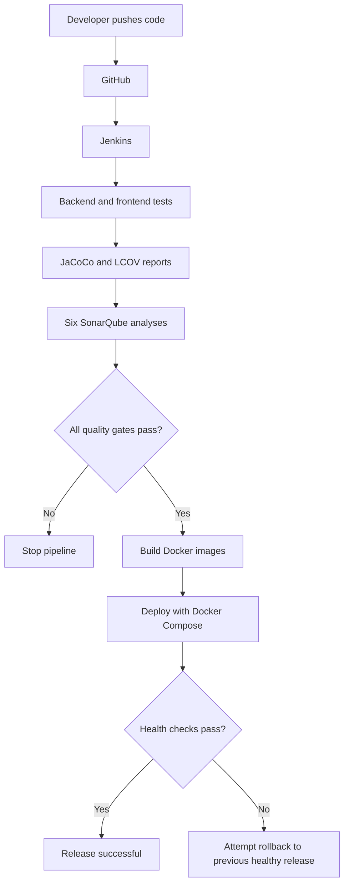

# Buy01 — Microservices Marketplace with CI/CD
;;
A full-stack marketplace built with **Spring Boot microservices** and **Angular**, with an automated **Jenkins + SonarQube** pipeline for testing, code analysis, and Docker deployment.

Buyers can browse products; sellers can manage their catalog and upload product images. The project also demonstrates service discovery, event-driven communication, security, code coverage, quality gates, and deployment health checks.

## At a glance

| Layer | Technology | Responsibility |
| --- | --- | --- |
| Frontend | Angular | Marketplace UI for clients and sellers |
| Backend | Spring Boot | User, Product, Media, Gateway, and Discovery services |
| Data | MongoDB | Application data |
| Events | Apache Kafka | Asynchronous service events |
| Media | Cloudinary | Uploaded product images |
| CI/CD | Jenkins | Tests, packaging, scanning, building, deployment |
| Code quality | SonarQube | Static analysis and quality gates |
| Coverage | JaCoCo, LCOV | Java and frontend test coverage |
| Infrastructure | Docker Compose + Docker-in-Docker | Isolated services and application deployment |

## How it works



The application runs inside the `jenkins-docker` Docker daemon. The host's normal `docker ps` shows infrastructure containers; use `docker exec jenkins-docker docker ps` to inspect deployed application containers.

## Requirements

- Linux, Git, OpenSSL, Docker Engine, and Docker Compose v2
- Permission to run Docker commands
- A GitHub account/token with read access to the repository
- Cloudinary credentials if you want to test image uploads
- Sufficient free memory and disk for Jenkins, SonarQube, and builds (approximately 8 GB available RAM is a useful starting point)

SonarQube's Elasticsearch needs a suitable host setting:
.
```bash
sysctl vm.max_map_count
```

If it is below `524288`, ask your system administrator to configure it. This is a **host** setting, not a Docker cache problem.

## Quick start — fresh installation

> Commands below are for **Bash on Linux**, from the repository root. This is a fresh-install guide: do not overwrite existing secrets or delete volumes when updating an existing installation.

### 1. Clone and prepare configuration

```bash
git clone https://github.com/anass-asbai/safe-zone.git
cd safe-zone

umask 077
mkdir -p jenkins-lab/jenkins-secrets
chmod 700 jenkins-lab/jenkins-secrets
cp jenkins-lab/.env.example jenkins-lab/.env
cp .env.example jenkins-lab/jenkins-secrets/buy01-env
```

Edit these two files **before starting the application**:

| File | What to configure |
| --- | --- |
| `jenkins-lab/.env` | `SONAR_DB_PASSWORD` for SonarQube PostgreSQL |
| `jenkins-lab/jenkins-secrets/buy01-env` | `JWT_SECRET`, JWT expiration, MongoDB credentials, Cloudinary credentials, gateway keystore password |

Generate a JWT secret with `openssl rand -hex 32`. Keep all local secrets out of Git. The `buy01-env` file must contain valid shell `KEY=value` lines; quote values containing shell-special characters.

Create the Jenkins admin password and GitHub checkout credentials using hidden prompts:

```bash
read -rsp 'Jenkins admin password: ' value; echo
printf '%s\n' "$value" > jenkins-lab/jenkins-secrets/jenkins-admin-password
unset value

read -rp 'GitHub username: ' value
printf '%s\n' "$value" > jenkins-lab/jenkins-secrets/github-username
unset value

read -rsp 'GitHub read-access token: ' value; echo
printf '%s\n' "$value" > jenkins-lab/jenkins-secrets/github-pat
unset value
```

The Jenkins job checks out `main` from the repository configured in `jenkins-lab/jcasc/jenkins.yaml`. Update that URL if you use a fork, and push your Jenkinsfile changes before running the job.

### 2. Generate local HTTPS certificates

```bash
openssl req -x509 -newkey rsa:2048 -sha256 -nodes -days 365 \
  -keyout jenkins-lab/jenkins-secrets/gateway-keystore.key \
  -out jenkins-lab/jenkins-secrets/gateway-keystore.crt \
  -subj '/CN=localhost' \
  -addext 'subjectAltName=DNS:localhost,DNS:gateway,IP:127.0.0.1'

openssl pkcs12 -export -name gateway \
  -inkey jenkins-lab/jenkins-secrets/gateway-keystore.key \
  -in jenkins-lab/jenkins-secrets/gateway-keystore.crt \
  -out jenkins-lab/jenkins-secrets/gateway-keystore.p12

chmod 600 jenkins-lab/.env jenkins-lab/jenkins-secrets/*
```

Use **the same export password** you configured as `SERVER_SSL_KEY_STORE_PASSWORD` in `buy01-env`. These are self-signed **development** certificates, not public-production certificates.

### 3. Start SonarQube and PostgreSQL

```bash
docker compose -f jenkins-lab/compose.yml config --quiet
docker compose -f jenkins-lab/compose.yml up -d --wait --wait-timeout 900 sonar-db sonarqube
```

Open **http://localhost:9000**. On a new instance, log in with `admin` / `admin`, change the default password, and go to **My Account → Security**. Generate an administrator **User Token** (not a Project Analysis Token).

Save it without printing it:

```bash
read -rsp 'SonarQube administrator User Token: ' sonar_admin_token; echo
printf '%s\n' "$sonar_admin_token" > jenkins-lab/jenkins-secrets/sonar-bootstrap-token
unset sonar_admin_token
chmod 600 jenkins-lab/jenkins-secrets/sonar-bootstrap-token
```

### 4. Provision SonarQube projects and tokens

```bash
docker compose -f jenkins-lab/compose.yml --profile bootstrap run --rm sonar-init
```

Successful output should end with `Provisioning complete; recreate Jenkins to load secret files`.

The bootstrap prepares **six SonarQube projects**, their analysis tokens, and the internal Jenkins quality-gate webhook:

| Component | SonarQube project key | Jenkins credential ID |
| --- | --- | --- |
| Product Service | `buy01-product-service` | `sonar-product-token` |
| User Service | `buy01-user-service` | `sonar-user-token` |
| Media Service | `buy01-media-service` | `sonar-media-token` |
| API Gateway | `buy01-gateway` | `sonar-gateway-token` |
| Eureka Discovery | `buy01-discovery` | `sonar-discovery-token` |
| Angular frontend | `buy01-frontend` | `sonar-frontend-token` |

**Why this step comes first:** Jenkins loads local analysis-token files when its startup configuration runs. SonarQube projects do not need to exist for Jenkins to define a server installation, but valid projects and tokens are required for successful scans.

### 5. Start Jenkins

```bash
docker compose -f jenkins-lab/compose.yml up -d --build --wait --wait-timeout 900 docker jenkins
docker compose -f jenkins-lab/compose.yml ps
```

Open **http://localhost:8085**, sign in as `admin` using the password from step 1, and verify:

- **Manage Jenkins → System → SonarQube installations** shows `SonarQube` at `http://sonarqube:9000`.
- **Manage Jenkins → Credentials** contains the six SonarQube credential IDs.
- The `first-pipeline` job exists.

**Important JCasC check:** Having SonarQube settings inside `/casc/jenkins.yaml` does **not** prove Jenkins applied them. In **Manage Jenkins → Configuration as Code**, check the **last applied configuration path** and verify that the server installation is actually visible. If Jenkins applies `/tmp/jenkins-base.yaml` without the Sonar section, investigate the startup/JCasC generation path instead of manually adding the server or clearing Docker volumes.

### 6. Run the pipeline

In Jenkins, open **`first-pipeline` → Build Now → Console Output**.

The expected sequence is:

1. Checkout from GitHub.
2. Run backend tests, package JARs, and generate JaCoCo coverage.
3. Run Angular tests, generate LCOV coverage, and build the frontend.
4. Analyze all six projects in SonarQube and wait for their quality gates.
5. Only if all gates pass, build Docker images tagged with the Jenkins build number.
6. Deploy the application, check health, and attempt rollback when an eligible previous release exists and deployment health fails.

A green Jenkins result is meaningful only if the deployment and health-check stages ran as expected. **This setup builds images locally inside Docker-in-Docker; it does not push images to Docker Hub.**

### 7. Open and test the marketplace

| Service | URL |
| --- | --- |
| Marketplace | **https://localhost:4200** |
| Jenkins | http://localhost:8085 |
| SonarQube | http://localhost:9000 |

The browser may warn about the self-signed development certificate.

Test the end-to-end flow: register as a **SELLER**, create a product and upload an image; then register as a **CLIENT** and confirm the product appears. Cloudinary credentials are required for uploads.

Quick checks:

```bash
curl -kfsS -o /dev/null https://localhost:4200/index.html
curl -kfsS https://localhost:4200/actuator/health
docker exec jenkins-docker docker ps
```

The health response should include `"status":"UP"` when the gateway is healthy.

## Repository guide

| Path | Purpose |
| --- | --- |
| `Jenkinsfile` | CI/CD pipeline definition |
| `jenkins-lab/compose.yml` | Jenkins, Docker-in-Docker, SonarQube, PostgreSQL |
| `jenkins-lab/jcasc/jenkins.yaml` | Jenkins Configuration as Code source |
| `jenkins-lab/docker-entrypoint.sh` | Loads local secrets and prepares Jenkins configuration |
| `jenkins-lab/sonar-init/bootstrap.py` | Provisions SonarQube projects, tokens, and webhook |
| `jenkins-lab/jenkins-secrets/` | Local credentials and certificates — **never commit** |
| `product-service/`, `user-service/`, `media-service/` | Business microservices |
| `gateway/`, `discovery/` | API routing and service discovery |
| `frontend/` | Angular marketplace |

## Everyday commands

Start existing infrastructure:

```bash
docker compose -f jenkins-lab/compose.yml up -d --build
```

Check status and logs:

```bash
docker compose -f jenkins-lab/compose.yml ps
docker compose -f jenkins-lab/compose.yml logs --tail=100 jenkins sonarqube
docker exec jenkins-docker docker ps
```

After changing local secret files, recreate Jenkins so its entrypoint can reload them:

```bash
docker compose -f jenkins-lab/compose.yml up -d --force-recreate jenkins
```

Stop without deleting data:

```bash
docker compose -f jenkins-lab/compose.yml stop
```

**Avoid `down -v` for routine troubleshooting:** it removes persistent data such as Jenkins and SonarQube state.

## Troubleshooting

| Symptom | First thing to check |
| --- | --- |
| SonarQube Elasticsearch fails to start | Host `vm.max_map_count`, memory, and SonarQube logs |
| `Number of installations ... 0` | Jenkins **System → SonarQube installations** and actual JCasC source applied |
| `Not authorized to analyze` / HTTP 401 | Correct project key, matching analysis token, permissions |
| Quality Gate times out | SonarQube webhook delivery to `http://jenkins:8080/sonarqube-webhook/` |
| Coverage report missing | `target/site/jacoco/jacoco.xml` or `frontend/coverage/frontend/lcov.info` |
| Docker image/container not visible on host | Inspect nested daemon with `docker exec jenkins-docker docker ps` |
| MongoDB/PostgreSQL login fails after password change | Existing database volumes retain initialized credentials |

For a full failure, inspect the **first real error** in Jenkins Console Output, not just the final `Finished: FAILURE` line. Never paste tokens or secret-file contents into issue reports.

## Important limitations

- The GitHub webhook needs an externally reachable Jenkins URL; `localhost:8085` is not reachable by GitHub.
- SonarQube Community Build does not provide native PR/branch analysis. The [GitHub quality workflow](.ci/README.md) performs isolated whole-code scans on every branch and PR without overwriting the main dashboard.
- Bootstrap assigns the Buy01 Quality Gate: at least 80% overall/new-code coverage, zero overall bugs/vulnerabilities and zero new issues, at most 3% new duplication, and all new security hotspots reviewed. Frontend coverage additionally enforces 80% in four metrics
- The included self-signed certificates and Docker-in-Docker setup are intended for local development/lab use.
- Rollback is conditional on a previous healthy release and is not a substitute for database migration planning.

## Quality checks and reviews

See [.ci/README.md](.ci/README.md) for automatic scans, retained reports, required reviews, and the prepared GitHub branch-protection rule. Protected branches still require a qualifying GitHub plan for this private repository.

## Project status

The setup and pipeline above describe the **intended reproducible workflow**. Verify the live Jenkins build, quality-gate results, deployment, and application functionality before describing a release as successful.


